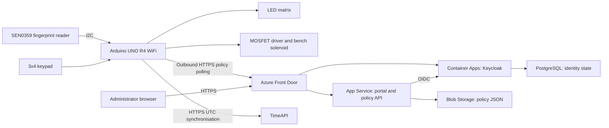

# UNO Access Lab

A fingerprint-or-PIN access-control bench prototype built with an Arduino UNO
R4 WiFi, an ASP.NET Core management portal, Keycloak and Azure.

The project connects digital identity to a physical controller: an administrator
sets an access policy in the portal, the UNO retrieves it, and the device checks
credentials and schedules locally before pulsing a solenoid. Fingerprints and
PINs are alternative entry methods, not multifactor authentication.

## Current status

- **Hardware:** SEN0359 fingerprint reader, membrane keypad, onboard matrix
  feedback and a MOSFET-driven 12 V bench solenoid are integrated.
- **Portal:** Keycloak sign-in, `platform-admin` authorisation, policy creation,
  activation, deletion and pause-all-access controls are implemented.
- **Policies:** fingerprint, PIN or either-method access; even/odd-minute rules;
  daily time windows; salted HMAC-SHA-256 PIN verifiers. Storage supports a local
  JSON file or Azure Blob Storage with ETag concurrency checks.
- **Remote device:** HTTPS policy polling, certificate validation, UTC clock
  synchronisation and Europe/London schedule evaluation are implemented.
  Invalid or stale policy/time denies access.
- **Hosting:** the portal/API runs on Azure App Service behind Front Door.
  Keycloak runs on Container Apps with PostgreSQL persistence. Infrastructure
  scripts and GitHub Actions deployment are included.

Remote hardware operation was confirmed on **22 November 2026**, including
cloud policy switching, PIN changes and even-minute schedules. The
[validation record](hardware/arduino/E2E_remote/validation.md) distinguishes
those results from the outstanding failure and endurance checks. Device
registration, authenticated device requests, telemetry and audit are still
future work; see the [roadmap](docs/roadmap.md).

## Architecture



The UNO initiates network connections; no home-router port forwarding is needed.
Fingerprint templates stay on the reader. Keycloak authenticates portal
administrators; the application manages physical-access policies.

## Run locally

Install the **.NET 10 SDK** and configure a Keycloak realm, confidential portal
client and `platform-admin` role using the
[portal setup guide](src/managementportal/README.md). Store the client secret
outside Git, trust the development certificate, then start the application:

```powershell
powershell.exe -NoProfile -ExecutionPolicy Bypass -File scripts/Initialize-PortalAuthentication.ps1
dotnet dev-certs https --trust
dotnet run --project src/managementportal
```

Open [https://localhost:7080/](https://localhost:7080/) and log in. The local
bench API is available on HTTP port 5080:

```powershell
curl.exe http://localhost:5080/api/policy/active
```

The active-policy endpoint returns a schema-2 JSON policy, or HTTP 204 when
access is paused. `/api/policies` lists all policies. Both are read-only and
currently anonymous. See the [API reference](src/policyapi/README.md) for the
wire format and PIN-verification contract.

## Hardware and deployment guides

- [Hardware overview and wiring](hardware/README.md)
- [E2E_remote: HTTPS policies and network time](hardware/arduino/E2E_remote/README.md)
- [E2E_local: LAN/HTTP baseline and manual clock](hardware/arduino/E2E_local/README.md)
- [UNO HTTPS diagnostic](hardware/arduino/https_test/README.md)
- [Portal hosting and deployment](infrastructure/managementportal/README.md)
- [Keycloak infrastructure and recovery](infrastructure/keycloak/README.md)
- [Keycloak login theme](infrastructure/keycloak/themes/README.md)

The hardware directory also contains the earlier component exercises. Copy a
sketch's `arduino_secrets.example.h` to `arduino_secrets.h` and configure it
locally. The portal and PIN-capable sketch must share the same private key;
the portal guide describes provisioning. Real credentials, policy data and
fingerprint templates must stay outside the repository.

## Validation

Run the existing application checks from the repository root:

```powershell
dotnet run --project tests/policyapi
dotnet run --project tests/managementportal
powershell.exe -NoProfile -File infrastructure/keycloak/tests/offline-validation.ps1
```

The .NET checks cover policy persistence, PIN protection, authentication,
authorisation, hosted ingress, health endpoints and storage configuration.
The Keycloak offline checks validate generated deployment configuration without
deploying Azure resources. Additional mocked infrastructure checks live beside
that script. [Remote clock assertions](tests/arduino/remote_clock/README.md)
cover calendar arithmetic, UK daylight saving transitions and clock expiry.
Compilation and software checks do not replace physical hardware tests.

## Prototype limits

- The anonymous API exposes policy metadata and PIN verifiers. Use synthetic
  bench policies; per-device authentication and authorisation are outstanding.
  The shared PIN key does not authenticate API requests.
- The local sketch uses HTTP on a trusted test LAN. Use the remote sketch for
  the HTTPS path.
- The reader's I2C link does not authenticate match messages, and the controller
  has no protected key storage or device-enforced secure update mechanism.
- The actuator has no independent pulse cutoff, and the current wiring omits a
  MOSFET gate pull-down. Disconnect its 12 V supply before firmware or wiring
  changes. See the hardware guide before powering it.
- Keycloak's Front Door backend-IP restriction does not isolate its origin to
  one Front Door profile. The infrastructure guide records this lab limitation.

This is a learning project, not a certified access-control product. Installation
on an occupied door needs a separate design for emergency exit, physical
security, electrical protection and failure handling.

## Design decisions

- [UNO R4 WiFi controller](docs/decisions/hardware/0001-use-arduino-uno-r4-wifi.md)
- [Solder-free SEN0359 reader kit](docs/decisions/hardware/0002-use-solder-free-fingerprint-kit.md)
- [Keycloak on Azure Container Apps](docs/decisions/software/0001-host-keycloak-on-azure-container-apps.md)

## Licence

Copyright 2026 Conor Woods. Original project code and documentation are licensed
under the [Apache License 2.0](LICENSE). Third-party components retain their own
licences and attribution notices.
